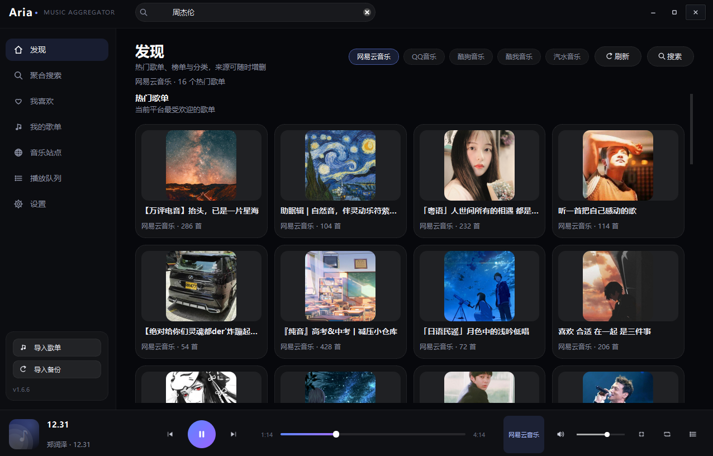
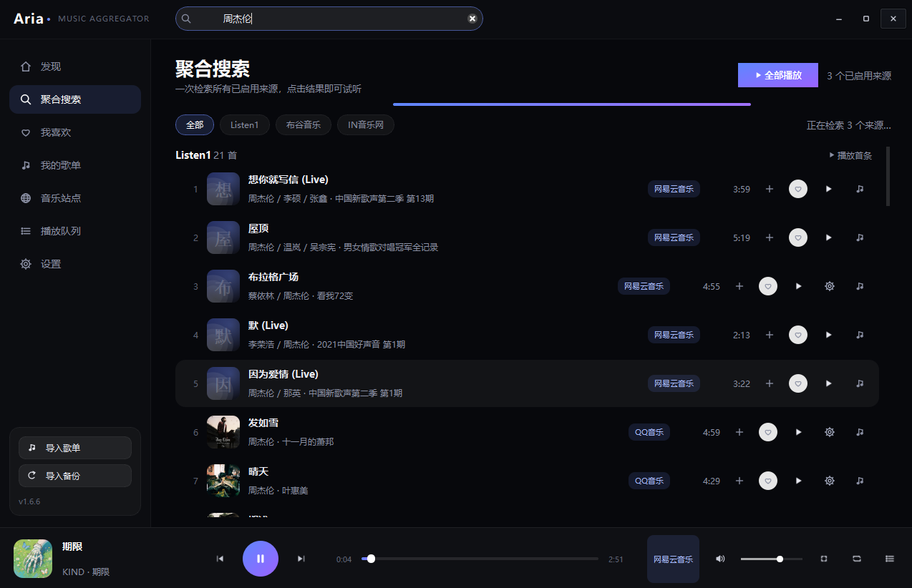
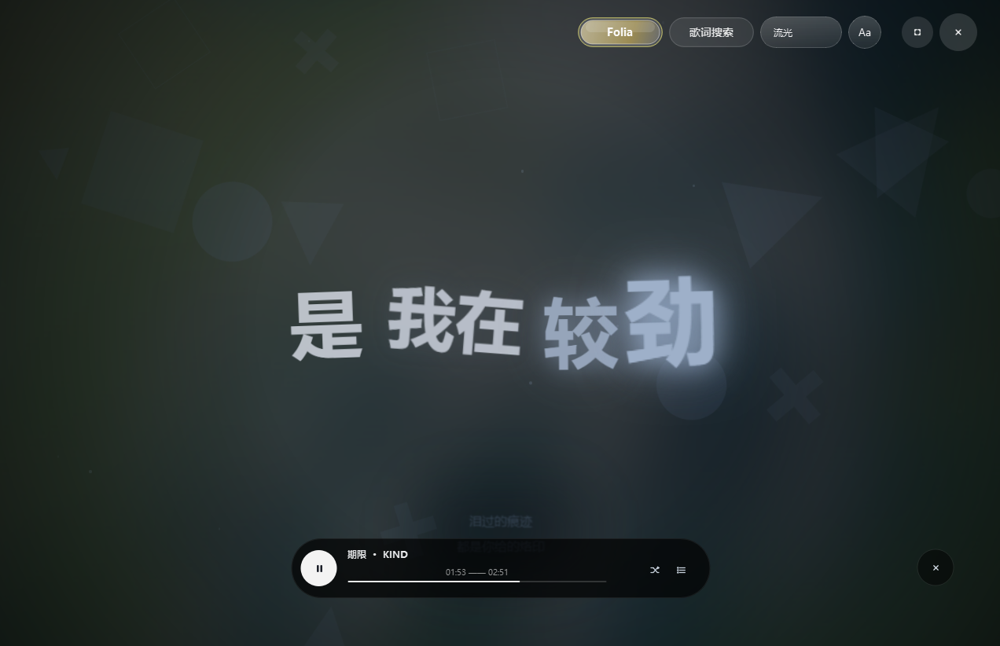

# Aria · 全网音乐聚合播放器

> 一个 Windows 桌面端音乐聚合器：把多个公开音乐接口收进同一个搜索框，搜到即可播放；内置可切换的 Folia 风格歌词舞台，本地缓存加速，数据不出本机。


---

下载链接：
百度云盘：https://pan.baidu.com/s/1dOsl4pYhFMkHsyJIipApCw?pwd=9nf2 提取码: 9nf2

夸克网盘：https://pan.quark.cn/s/d20445a13018

## 截图

| 发现页 | 聚合搜索 | 沉浸歌词 / Folia 舞台 |
| --- | --- | --- |
|  |  |  |

> 截图位于 `assets/` 目录，可随版本更新替换。

## 简介

Aria 基于 **PySide6 + Qt WebEngine** 构建，本地 SQLite 存储收藏、歌单、站点与设置，可添加开源服务器获取音源。内置一个打包进安装包的 **Node 侧车**（Listen1），在一个来源内聚合网易云、QQ、酷狗、酷我、汽水五个平台的歌单、榜单、分类与搜索；其余音源可通过官方 API、网页规则或从 GitHub 植入的聚合工具按需接入。

播放链路分两类处理：

- **聚合源**（Listen1、自定义 JSON、GitHub 植入工具等）：聚合自定义开源网站或者免费音乐网站，免费享受歌曲。
- **官方 API**（iTunes、Audius 等）：保持本地 Range 代理流式播放，不预下载、不占缓存。

## 核心特性

### 多源聚合搜索
- 一次并发检索所有已启用来源，单源失败不影响其他源；结果按来源分组，带来源标签、时长与封面。
- 来源 chip 可单独筛选；内置来源与自建来源一样可启用、停用、测速、编辑、删除。

### 最优音源匹配
- 收藏、导入歌单、详情页里的曲目只保留元数据，点播时并发搜索全部来源，按标题相似度、歌手、专辑、时长与平台权重打分，自动挑出可播放的整首音源。
- 歌名与歌手一致即直接播放最优音源；专辑只参与候选排序，不作为必须匹配项。
- 无法唯一确定时弹出「你可能想听这首歌」候选列表，按 **作者 > 专辑 > 歌名（模糊）** 排序，可直接播放；勾选「默认匹配该歌曲」后持久化绑定，下次直接走该源，不再搜索或弹窗。

### 内置 Folia 歌词舞台
点播放条封面进入沉浸歌词页，主页保持干净、不显示歌词。提供两种可切换形态：

- **经典模式**：多行歌词，当前行逐字渐变高亮，非当前行按距离衰减透明度，换行平滑滚动。
- **Folia 舞台**：深蓝几何装饰背景、白色衬线词级错位大字、当前词琥珀发光，底部展示当前句译文与黑色胶囊播放条。舞台复用 Folia classic 的 Visualizer、几何背景、主题与歌词样式，构建为独立页面，由 Qt WebEngine 通过本机回环加载，仅注入当前歌曲、歌词与播放进度。

歌词相关能力：
- 「歌词搜索」可检索同名歌词版本，确认替换后经典模式与 Folia 舞台使用同一份结果；外文歌词带译文时原文与译文同时展示。
- 可把当前版本存为「默认歌词」，以后播放同一首歌直接使用。
- `Aa` 菜单分别调整字体大小、动画节奏与歌词密度；滚轮翻词、点行跳转；`F11` 全屏，全屏后自动隐藏 UI，移动鼠标呼出。

### 跨源收藏与歌单
- 收藏以「归一化歌名 + 歌手」为主键，同一首歌无论来自哪个来源，其他来源的结果都会显示红心。
- 支持导入网易云 / QQ / 酷狗歌单分享链接，以及 Aria 自包含的 `aria://playlist/…` 静态分享链接（数据压缩在链接内，不依赖第三方服务）。
- 可新建本地歌单、把任意曲目加入歌单；同一歌单内按歌名 + 歌手去重。

### 播放与队列
- 四种播放模式：列表循环、单曲循环、列表随机、纯随机。
- 弹出式播放列表，单击即播；队列自动持久化，重启后仍在。
- 提前 5 秒静默预取下一首；聚合源边下边播，下载完成原子转正为正式缓存，减少等待缓冲时间。

### 本地缓存与设置
- 缓存目录与上限可在设置页修改，默认安装盘下的 `cache`，上限默认 200 首，超出按最久未播放（LRU）淘汰；当前播放、预取与写入中的条目受保护。
- 可配置 HTTP 代理，保存后所有来源请求、封面加载与缓存下载统一走代理。

### 备份与恢复
- 单个 JSON 备份包含：我喜欢、我的歌单（含曲目）、音乐站点（含后添加来源）、默认音源匹配绑定、默认歌词。
- 导入可选「覆盖导入」或「合并导入」，合并只补充本机没有的条目，不冲掉已有数据；换设备可完整找回。

## 内置与可接入音源

| 来源 | 类型 | 说明 |
| --- | --- | --- |
| Listen1 | 内置 Node 侧车 | 一个来源聚合网易云 / QQ / 酷狗 / 酷我 / 汽水，歌单、榜单、分类、搜索与取流；付费曲目受限时自动换源 |
| GitHub 聚合工具 | 用户植入 | 从「音乐站点 → 添加开源项目」接入，健康检查通过后参与发现、搜索与匹配 |
| iTunes（可选） | 官方 API | Apple 官方 30 秒试听流，流式播放，不缓存 |
| Audius（可选） | 官方 API | 官方整首流，流式播放，不缓存 |
| 其它官方 API（自定义） | 官方 API | 自填接口、字段映射、请求头与 Key，可逐条选择流式或缓存 |
| 网页规则源（可选） | HTML 规则引擎 | 输入站点地址自动分析搜索入口、结果列表、详情链接与音频地址，失败可手动配置；不预置 |


## 接入自定义聚合工具

在「音乐站点 → 添加开源项目」输入形如 `https://github.com/owner/repo` 的地址，Aria 读取仓库里的 `aria-tool.json`（推荐）或服务端启动脚本，选中入口后下载到 `%APPDATA%\Aria\tools\`，用内置 Node 运行时启动，并通过 `127.0.0.1` + 随机 token 做健康检查。

工具需实现的最小 HTTP 契约：

| 路由 | 返回 |
| --- | --- |
| `GET /health` | `{"ok": true}`，需带 `X-Aria-Token` |
| `GET /recommend` | `{"items": [歌单卡]}` |
| `GET /charts` | `{"items": [榜单卡]}` |
| `GET /categories` | `{"groups": [分类组]}` |
| `GET /playlist?id=` | `{"info": 歌单信息, "tracks": [曲目]}` |
| `GET /chart?source=&id=` | `{"info": 榜单信息, "tracks": [曲目]}` |
| `GET /search?source=&keyword=&limit=` | `{"tracks": [曲目]}` |
| `GET /stream?id=` | `{"url": "音频直链"}` |

`aria-tool.json` 示例：

```json
{
  "id": "my-aggregator",
  "name": "我的聚合",
  "short": "聚合",
  "accent": "#33AAFF",
  "description": "示例聚合工具",
  "start": ["node", "server.js"],
  "discover": true,
  "timeout": 10
}
```

## 技术栈

- **界面**：PySide6（Qt Widgets）、Qt WebEngine（Folia 舞台）
- **侧车**：Node.js 本地子进程，仅监听 `127.0.0.1`，进程级随机 token 校验
- **存储**：SQLite（站点、收藏、歌单、队列、历史、设置）
- **打包**：PyInstaller 目录式打包 + Inno Setup 安装包

## 数据与隐私

- 用户数据存于 `%APPDATA%\Aria\aria.db`，异常日志在同目录 `error.log`；备份默认写到该目录，也可自选路径。
- 缓存只是本机播放加速用的临时音频，不提供导出或分享入口；可在设置页一键清空。
- 搜索为本地直连，查询不会上传到本项目之外的服务器（歌词、封面、推荐与取流请求除外）。

## 免责声明

- 仅聚合公开、无需登录的搜索接口，不做登录态抓取，不绕过任何版权保护。
- 试听 / 播放地址与版权归原平台所有，请遵守对应站点的使用条款；缓存文件请勿用于二次分发。
- 内置 Listen1 依据 MIT 许可证分发；Folia 舞台前端依据 AGPL-3.0 分发，许可证全文见安装目录 `licenses\`。
